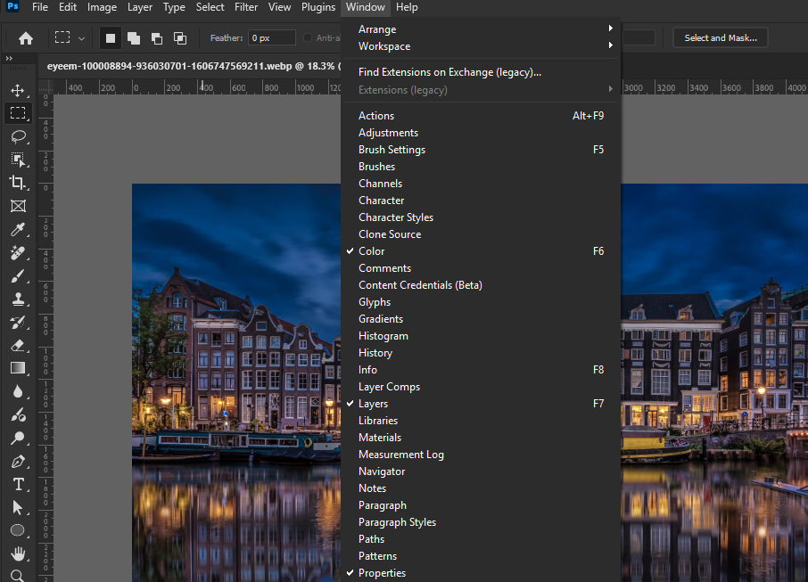
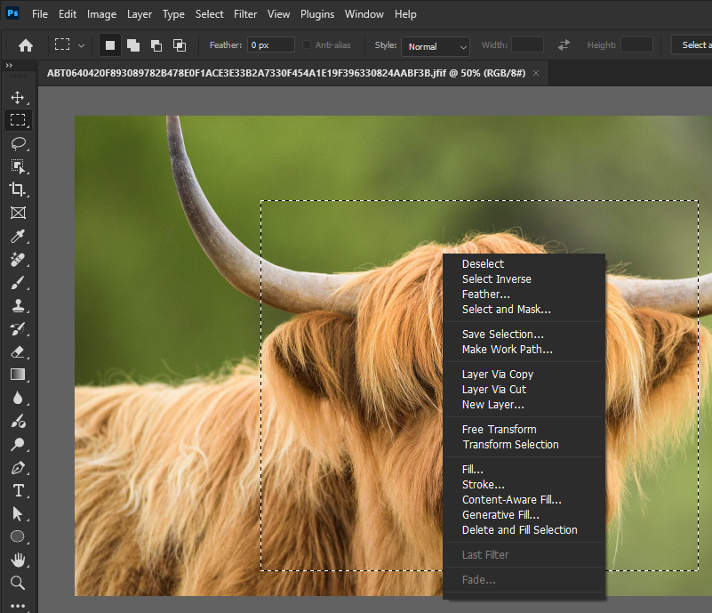

# Photoshop Dark Menus

This Windhawk mod enables dark menus (top-bar dropdowns and context menus), dark dropdown lists, dark message boxes and dark dialog title bars in Adobe Photoshop on Windows, with fully customizable colors. No other mod is needed alongside it.

Everything happens inside the Photoshop process. No system colors are changed and no other application is affected.

## Photoshop Dark Menus or Adobe Dark Menus

[Adobe Dark Menus](https://windhawk.net/mods/adobe-dark-menus) ([source](https://github.com/sabergraphics/adobe-dark-menus)) is a newer mod from the same author. It also covers Illustrator, InDesign, After Effects, Premiere Pro and other Adobe apps, along with their menu bars. In Photoshop it does what this mod does, except that it leaves message boxes light.

- **Photoshop Dark Menus** (this mod) changes Photoshop and nothing else. Pick it if Photoshop is the only Adobe app you want changed, or if you want its message boxes dark as well.
- **Adobe Dark Menus** handles all the Adobe apps in one mod. Pick it if you want a single mod for all of them.

**Use one or the other, not both.** Both hook the same functions inside Photoshop, and running the two together has not been tested. If you switch to Adobe Dark Menus, disable this mod.

## Screenshots

## Requirements

- **[Windhawk](https://windhawk.net) 1.5 or later.** The mod uses the typed `SetFunctionHook` helper, which was added in 1.5.
- **Adobe Photoshop for Windows.** Developed and tested against Photoshop 2026. The mod hooks generic Windows drawing calls rather than anything specific to a Photoshop build, so earlier versions are likely to work, but they have not been tested.
- **Windows.** Photoshop's own menus and dropdown lists work on any build Windhawk and your Photoshop version support. Three parts need a newer Windows: the menus Windows draws itself need Windows 10 1903 or later, dark message boxes need Windows 10 1809 or later, and colored title bars need Windows 11 (Windows 10 2004 or later gets a dark title bar without the custom color). On an older build those parts are simply left light.

There is no toolchain to install. Windhawk compiles the mod itself with its own bundled compiler.

## Installation

### From the official Windhawk repository (recommended)

1. Open Windhawk
2. Search for [Photoshop Dark Menus](https://windhawk.net/mods/photoshop-dark-menus)
3. Click **Install**

Photoshop does not need to be restarted. The mod picks up the menus and dropdown lists that already exist in a running Photoshop.

### From this repository (latest version)

The copy here can be ahead of the version listed on windhawk.net.

1. Download [`photoshop-dark-menus.wh.cpp`](https://github.com/sabergraphics/photoshop-dark-menus/blob/main/photoshop-dark-menus.wh.cpp)
2. Open Windhawk
3. Click **Create a new mod**
4. Replace everything in the editor with the contents of the downloaded file
5. Compile it, and Windhawk will build and install it

### If you already use Dark mode context menus

Earlier versions recommended running [Dark mode context menus](https://windhawk.net/mods/dark-menus) alongside this mod, for the few menus in Photoshop that Windows draws. This mod now darkens those itself, so it is no longer needed for Photoshop. If you run it for your other apps it can stay on, but it can also rewrite the menu background this mod sets. If Photoshop's menus come out in its colors rather than yours, exclude `Photoshop.exe` from it in its Advanced settings.

## Options

The following settings can be customized in the Windhawk mod panel:

- **Menu Background Color**: Background color for all menu popups (Default: `#2D2D2D`).
- **Menu Text Color**: Text color for active items (Default: `#DCDCDC`).
- **Highlight Background Color**: Color when hovering over an item (Default: `#505050`).
- **Highlight Text Color**: Text color when hovering over an item (Default: `#FFFFFF`).
- **Separator Line Color**: Color for separator lines. Set to match the background color to hide them completely (Default: `#383838`).
- **Disabled Text Color**: Text color for disabled menu items (Default: `#808080`).
- **Border Color**: Color of the popup frame. Leave empty to keep the system frame (Default: `#2D2D2D`).
- **Theme Dropdown Lists**: Darken the dropdown lists as well, using the colors above (Default: on).
- **Darken Menus Windows Draws**: Use Windows' dark menu theme for the few menus Windows draws itself, such as the context menu on a document tab (Default: on).
- **Darken Message Boxes**: Darken Photoshop's message boxes, such as the "Save changes" prompt, using the colors above (Default: on).
- **Dark Title Bars**: Color the title bars of Photoshop's dialogs to match the menus (Default: on).
- **Title Bar Color**: Leave empty to match the menu background color (Default: empty).
- **Title Bar Text Color**: Leave empty to let Windows choose, which dims the text of an inactive window (Default: empty).

Colors can be given as `#RRGGBB` or the short `#RGB` form.

## Scope

The menu bar itself (File, Edit, Image, ...) is drawn by Photoshop's own UI framework and already follows Photoshop's interface theme; this mod covers the dropdown popups and context menus.

Menus Windows draws itself take Windows' own dark colors rather than the colors set here, and so do the buttons in a message box.

A message box holding anything beyond an icon, text and push buttons, such as a "Don't show again" check box, stays light.

The font browser and the Glyphs panel's character cells also stay light. Photoshop paints those from its own palette rather than from any system color, with its dark chrome and their light content coming from the same calls in the same window, so there is nothing for an in-process hook to answer. Recoloring them would mean matching color values instead, in a window class Photoshop also uses for swatches and color pickers, where a light fill is the content rather than a background.

## How it works

Photoshop's menus look like classic unthemed Win32 menus, but they are not. The process is themed (`IsAppThemed() == 1`), and Photoshop **owner-draws every menu item itself** through `AdobeOwl.dll`, using plain GDI, inside its own process. Instrumenting a running Photoshop shows the popups going up via `TrackPopupMenuEx`, and each item being painted with:

- `FillRect(hdc, &rc, (HBRUSH)(COLOR_MENU + 1))` for the item background, and `(HBRUSH)(COLOR_HIGHLIGHT + 1)` for the hovered item. These **system color pseudo-handles** are resolved inside `user32` from shared memory, so they never reach `GetSysColor` or `GetSysColorBrush`, which is why hooking those alone appears to do nothing.
- `GetSysColor(COLOR_MENUTEXT / COLOR_GRAYTEXT / COLOR_HIGHLIGHTTEXT)` for item, disabled and selected text.
- Photoshop's own 1px `FillRect` for separator lines.

So every pixel of a menu item is reachable from inside the process:

| Element | How Photoshop draws it | How the mod reaches it |
| --- | --- | --- |
| Item background | `FillRect` with a `COLOR_MENU` pseudo-handle | `FillRect` hook re-resolves the pseudo-handle through the mod's colors |
| Hover highlight | `FillRect` with a `COLOR_HIGHLIGHT` pseudo-handle | same |
| Item / disabled / selected text | `GetSysColor` | `GetSysColor` hook, scoped to the item being painted |
| Separators | own 1px `FillRect` | `FillRect` / `PatBlt` hook, scoped to menu DCs |
| Popup background around items | system, from `COLOR_MENU` | `MENUINFO::hbrBack` at `WM_INITMENUPOPUP` |
| Popup frame | system, kernel-side, from the 3D colors | repainted from a subclass on the popup |
| Scroll arrows of a long menu | system, kernel-side, in the system menu text color | recolored from the same subclass after each scroll |
| Dropdown list background | `GetSysColorBrush(COLOR_WINDOW)` | `GetSysColorBrush` hook, scoped to the list's painting |
| Dropdown row background | `GetSysColor(COLOR_WINDOW)`, or a `COLOR_HIGHLIGHT` pseudo-handle | `GetSysColor` and `FillRect` hooks, same scope |
| Dropdown row text | `GetSysColor(COLOR_WINDOWTEXT)` in one list, `COLOR_MENUTEXT` in another | `GetSysColor` hook, same scope |
| Menus Windows draws, such as the document tab context menu | Windows' theme engine, in light colors | uxtheme's dark menu theme, through `SetPreferredAppMode(ForceDark)` and `FlushMenuThemes` |
| Message box background and text | Photoshop's `PSDialogBox` window, in its own paint | subclass that paints the background in place of Photoshop's and answers the text colors |
| Message box buttons | stock push buttons, in the light theme | Windows' dark button theme, through `SetWindowTheme` |
| Dialog title bars | DWM, in the system colors | `DwmSetWindowAttribute` with the dark flag and the caption color |

The system color overrides apply **only while a menu item or a dropdown row is actually being painted**, inside a menu's `WM_DRAWITEM` or inside the list window's own paint messages, rather than for as long as a menu happens to be open. That matters because `TrackPopupMenu` runs a modal message loop which keeps dispatching to every other window on the thread, so a panel repainting behind an open menu would otherwise come out in menu colors. The popup frame is the one part drawn kernel-side, where no user-mode hook can reach it, so the popup window is subclassed and its frame repainted after the system has drawn it.

The dropdown lists are stock Win32 combo boxes: Photoshop owner-draws the rows but reads their colors from the system, and the list itself is user32's `ComboLBox` window. It does not read them consistently, so both routes are covered. One list asks for a color and fills with a brush it makes; another fills with a `(HBRUSH)(COLOR_X + 1)` pseudo-handle. One takes its row text from `COLOR_WINDOWTEXT`, another from `COLOR_MENUTEXT`. Only lists that Photoshop draws itself and that drop down are themed: a stock list, as some plugin dialogs use, keeps the system colors, since Windows fills its background from a brush no hook sees.

Those list windows are created once per combo box and kept for the life of the process, usually long before the mod loads, so catching them at creation is not enough. They are found instead from the messages sent while they paint: `WM_DRAWITEM` names the list in `hwndItem`, and `WM_CTLCOLORLISTBOX` names it in `lParam`. Menu popups are caught with a CBT hook at creation, with a sweep for any that already existed.

The menus Windows draws itself are a different case. The theme engine paints them, below anything a hook here can reach, but it has a dark variant that is off unless a process asks for it. The mod asks for it the way [Dark mode context menus](https://windhawk.net/mods/dark-menus) does, and puts the process back when it is disabled. Those menus take Windows' own dark colors.

Photoshop's message boxes, such as the prompt to save changes before closing, are its own `PSDialogBox` window holding only stock Windows controls: an icon, a line of text and push buttons. Photoshop paints the white background itself, and builds the box while it is already showing. So the mod subclasses the window, paints the background in the menu color in place of Photoshop's, answers the text in the menu colors, and checks what the box holds each time it paints, giving each push button Windows' own dark button theme as it appears. Only a box holding nothing but those controls is changed, which leaves every dialog Photoshop paints itself alone.

Title bars are colored by DWM on request, so nothing is drawn: the mod sets the dark flag and the caption color on each Photoshop window with a standard title bar, which in practice means its dialogs, just before the window is shown. Photoshop's main window draws its own title bar and is left alone. This is measured per window rather than decided by class, since the main window and the dialogs belong to the same app.

## Why a standalone mod?

The system-wide [Dark mode context menus](https://github.com/MGGSK/DarkMenus) (`dark-menus`) mod switches a process to uxtheme's dark menu theme with `SetPreferredAppMode` + `FlushMenuThemes`. That cannot help with Photoshop's own menus: uxtheme only themes menus it draws, and Photoshop draws its menu items itself, so there is nothing for the dark menu theme to attach to.

This mod intercepts Photoshop's own drawing instead, uses the same dark theme for the few menus Windows draws, and adds:

1. Fully customizable colors (background, text, highlight, highlight text, separator, disabled text, border, title bar).
2. Photoshop-scoped GDI hooks. Re-resolving system color pseudo-handles and recoloring 1px fills is safe when scoped to one application's menus; it would risk false positives across every app in a global `@include *` mod.

## Reporting a bug

1. Check the open [Issues](https://github.com/sabergraphics/photoshop-dark-menus/issues) first, in case it is already known
2. Click **New issue**
3. Put a short description of the problem in the title, and the detail in the body

Menu drawing depends on more of the environment than most bugs do, so please include:

- Your Photoshop version, and which menu or dropdown list is wrong
- Your Windows version and display scaling, for example 150%
- Your Windhawk version and the mod version
- A screenshot, which is usually worth more than a description here
- Whether [dark-menus](https://windhawk.net/mods/dark-menus) is also installed. It hooks `SetMenuInfo` and can rewrite the same menu background, so it is useful to know whether the problem survives turning it off.
- The mod's log, if you can get it. Turn on logging for the mod in Windhawk's advanced settings, reproduce the problem, and paste what the log shows.

## Requesting a feature

1. Go to [Issues](https://github.com/sabergraphics/photoshop-dark-menus/issues)
2. Click **New issue**
3. Describe the feature in the title, and what it would be useful for in the body

Requests to cover a part of the interface this mod does not reach yet are welcome, but read [Scope](#scope) first: some of them are ruled out by how Photoshop paints, rather than by effort.

## Asking a question

1. Go to [Discussions](https://github.com/sabergraphics/photoshop-dark-menus/discussions)
2. Click **New discussion**
3. Pick the **Q&A** category
4. Write the question and start the discussion

For anything about Windhawk itself rather than this mod, the [Windhawk mods discussions](https://github.com/ramensoftware/windhawk-mods/discussions) are the better place to ask.

## License

MIT. See [LICENSE](LICENSE).

## Related resources

- [Windhawk](https://windhawk.net)
- [Official Windhawk mod repository](https://github.com/ramensoftware/windhawk-mods)
- [This mod on windhawk.net](https://windhawk.net/mods/photoshop-dark-menus)
- [Dark mode context menus](https://github.com/MGGSK/DarkMenus), the system-wide mod whose dark menu technique this one uses for the menus Windows draws
- [Adobe Dark Menus](https://windhawk.net/mods/adobe-dark-menus), the same theming for all the Adobe apps in one mod
